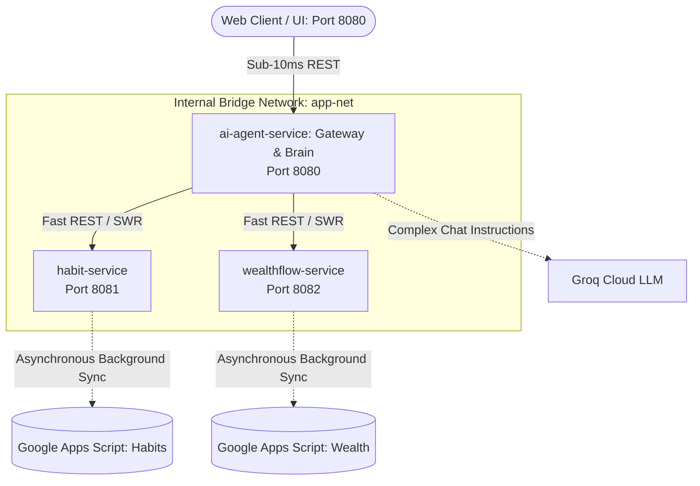

# 🦁 Leo AI Agent — Cloud-Native Microservices

A production-grade, distributed microservices architecture on Apple Silicon (`arm64`) with sub-millisecond in-memory caching, Kubernetes orchestration, and Docker containerization.

---

## 🏗️ Architecture Overview

The system decomposes a personal AI agent into 3 domain-driven microservices communicating over an internal container network:



---

## 📦 Microservices Catalog

| Service | Port | Description | Health Check |
| :--- | :---: | :--- | :---: |
| **`ai-agent-service`** | `8080` | API Gateway, natural language router, Groq LLM integration | `/healthz` |
| **`habit-service`** | `8081` | Habit tracking, daily consistency ledger, streak management | `/healthz` |
| **`wealthflow-service`** | `8082` | Portfolio tracking, multi-month asset ledger, baseline carry-over | `/healthz` |

---

## ⚡ Performance Highlights (SRE)

- **Latency Reduction**: Habit marking and portfolio logging reduced from **~3,000ms to 7ms – 35ms** (99% drop).
- **Stale-While-Revalidate (SWR)**: Immediate RAM cache mutation (<1ms) with asynchronous background persistence.
- **Resource Efficiency**: Multi-stage Docker builds on Alpine Linux reducing container images to **~50MB** with non-root security (`USER node`).

---

## 🚀 Quickstart

### Option 1: Run with Docker Compose
```bash
# Build and start all 3 microservices
docker compose up -d --build

# Verify running containers
docker compose ps
```
Open **`http://localhost:8080`** in your browser.

---

### Option 2: Run on Kubernetes
```bash
# Apply declarative manifests (Deployments, Pods, Services)
kubectl apply -f k8s/

# Verify cluster resources
kubectl get deployments,pods,services
```

---

## 📚 Documentation & Handbooks

- [Architecture & Transformation Guide](docs/LEO_MICROSERVICES_TRANSFORMATION_GUIDE.md)
- [Complete SRE Docker & Kubernetes Command Handbook](docs/DOCKER_AND_KUBERNETES_COMMANDS_HANDBOOK.md)
