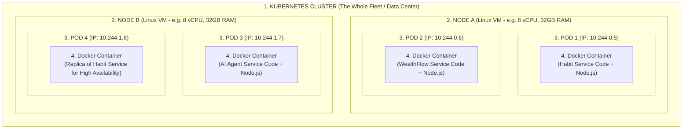
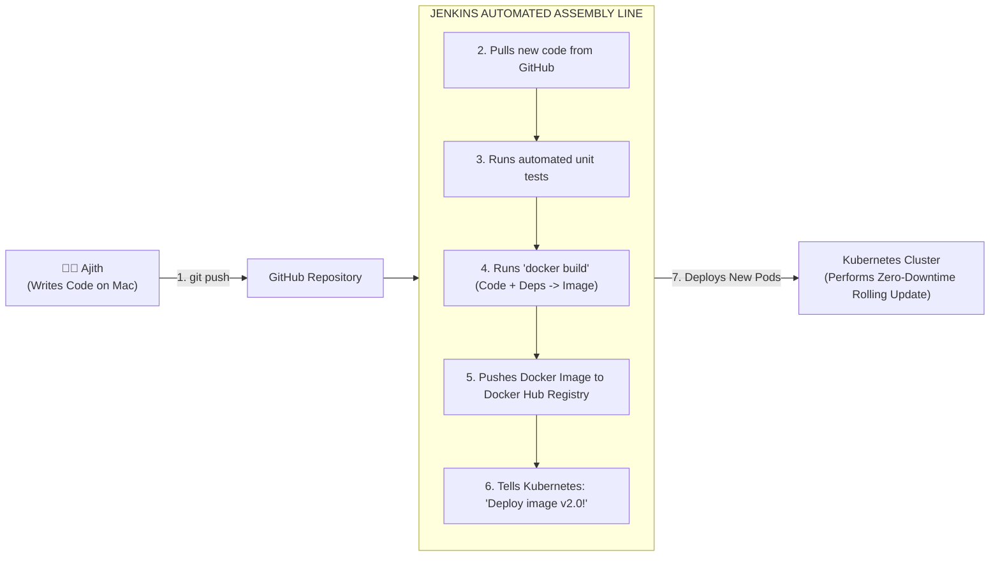

# DevOps Demystified: Containers, Pods, Nodes & Jenkins
## A Visual, Plain-English Guide for Enterprise Engineers

---

## 1. Quick Answers to Your Questions

> **Q: Can we treat a Docker container as "App Code + Dependencies"?**  
> **A: YES! Exactly.** A container is your code + its language runtime (Node.js/Java) + system libraries + configs, all packaged in a lightweight, isolated box.

> **Q: Do we run Docker containers in Nodes (Linux VMs)?**  
> **A: YES!** A "Node" is simply the Linux server/VM that provides the raw CPU, RAM, and disk storage where things actually run.

> **Q: To manage those nodes, we use Kubernetes — so WHAT ARE PODS?**  
> **A: A Pod is the smallest deployable unit in Kubernetes that wraps your container.** Kubernetes never deploys a bare container directly; it always wraps it in a **Pod** (like a pea pod holding a pea).

---

## 2. The Hierarchy: The Russian Nesting Dolls

To understand how everything fits together, think of **Russian Nesting Dolls** (each layer sits inside the bigger layer):



---

## 3. Deep Dive: What is a Pod & Why Doesn't Kubernetes Run Containers Directly?

```
       A PEA POD                       A KUBERNETES POD
     ┌───────────┐                      ┌────────────────────────────┐
     │  ●  ●  ●  │                      │ ┌────────────────────────┐ │
     └───────────┘                      │ │    DOCKER CONTAINER    │ │
  A pod of peas holds                   │ │ (Your App Code + Deps) │ │
  one or more peas inside.              │ └────────────────────────┘ │
                                        │  • Own Private IP Address  │
                                        │  • Storage Volumes         │
                                        │  • Health Probes (/healthz)│
                                        └────────────────────────────┘
```

### The 4 Reasons Kubernetes Uses Pods Instead of Bare Containers:

#### 1. Network Identity (Each Pod Gets Its Own Virtual IP)
In raw Docker, if you run 3 containers on the same VM, they all share that VM's IP address and fight over ports (e.g. two apps can't both use port 8080).  
In Kubernetes, **every Pod gets its own unique IP address** (e.g. `10.244.0.15`). Inside Pod 1, your app can listen on port 8080; inside Pod 2, another app can also listen on port 8080 without any port collision!

#### 2. The "Sidecar" Pattern (Two Containers Working as One)
In 95% of cases: **1 Pod = 1 Container** (your app).  
However, as an **SRE**, you sometimes need an assistant helper container running alongside your main app:
* **Container 1 (Main App)**: Your Habit Service.
* **Container 2 (SRE Sidecar)**: A lightweight log shipper (like FluentBit) that reads your app logs and ships them to Elasticsearch.  
Because both containers live in the **same Pod**, they share the same disk storage and can talk to each other over `localhost`!

#### 3. Atomic Scheduling
Kubernetes manages Pods as indivisible units. When a Node dies, Kubernetes doesn't move individual loose containers; it picks up the entire **Pod** and schedules it onto a healthy Node.

#### 4. Container Agnostic
Kubernetes was designed to be universal. By introducing the **Pod abstraction layer**, Kubernetes doesn't care whether the container inside is Docker, `containerd`, or `CRI-O`.

---

## 4. The 4 Levels Compared: Plain English vs. Enterprise (TCS/FIS)

| Level | Plain English Analogy | Traditional Enterprise (TCS / FIS) | Kubernetes Cloud-Native |
| :--- | :--- | :--- | :--- |
| **1. The App Container** | The shipping box containing your code, runtime, and dependencies. | A standalone compiled WAR/JAR file + JDK running on a server. | **Docker Container** |
| **2. The Pod** | The wrapper/capsule holding the container and giving it an IP address. | A single operating process (PID) with assigned network port. | **Kubernetes Pod** |
| **3. The Node** | The physical truck or warehouse floor providing power and space. | A physical Dell rack server or VMware Linux VM (`app-srv-01`). | **Kubernetes Node** |
| **4. The Cluster** | The entire logistics fleet managed by one headquarters. | The whole data center farm with 50 VMs behind an F5 Load Balancer. | **Kubernetes Cluster** |

---

## 5. Where Does Jenkins Fit Into All This?

If Docker is the **shipping container** and Kubernetes is the **cargo ship**, then **Jenkins is the automated robotic factory assembly line**.



### Why Jenkins is Crucial for an SRE:
Without Jenkins, a developer would have to manually:
1. Build code on their laptop.
2. Manually run `docker build`.
3. Manually upload it to a server.
4. Manually SSH into servers to restart them.

**Jenkins eliminates all that manual toil.** You simply push code to Git, and Jenkins builds the Docker container, tests it, and safely updates the Kubernetes Pods automatically.

---

## 6. Summary: The Golden Formula

$$\text{Docker Image} = \text{Source Code} + \text{Runtime (Node/Java)} + \text{Dependencies (npm/maven)}$$

$$\text{Pod} = \text{Running Container} + \text{Unique Virtual IP} + \text{Storage Volume} + \text{Health Probes}$$

$$\text{Node} = \text{Linux Server (VM)} \text{ that hosts multiple Pods}$$

$$\text{Kubernetes} = \text{The Brain that manages all Nodes and schedules Pods}$$

$$\text{Jenkins} = \text{The Robot that builds the Docker Images and deploys them to Kubernetes}$$
