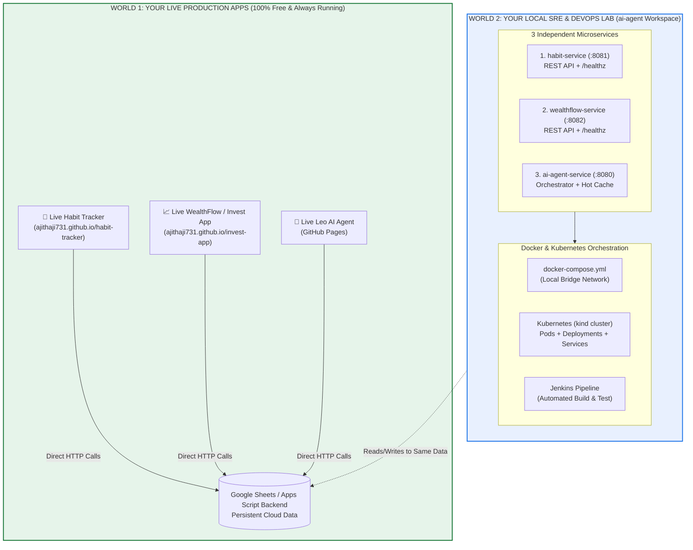
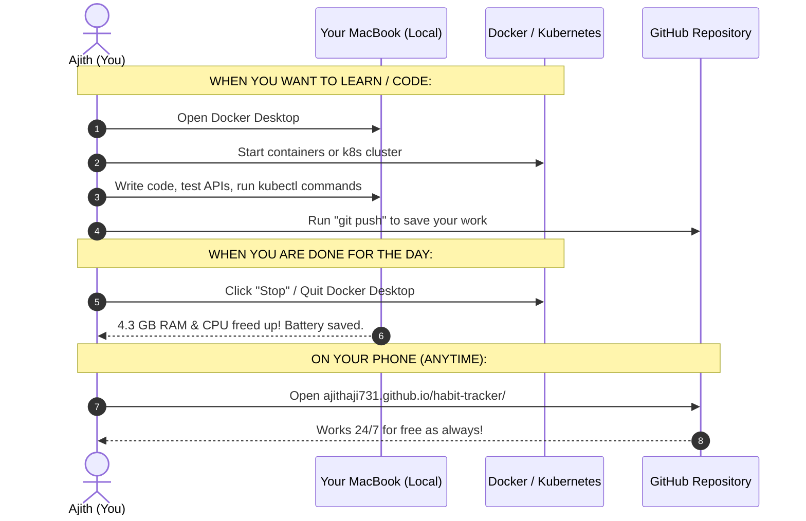

# Architecture Guide: Live Production Apps vs. DevOps Engineering Lab

---

## 1. The Core Guarantee: Zero Impact on Your Live Apps

> [!IMPORTANT]
> **Your live apps will NOT be affected, changed, or broken in any way.**
> * 🌐 `https://ajithaji731.github.io/habit-tracker/` (100% Live, Free, Untouched)
> * 🌐 `https://ajithaji731.github.io/invest-app/` (100% Live, Free, Untouched)
> * 🌐 Your live AI Agent on GitHub Pages (100% Live, Free, Untouched)
> * 📊 Your Google Sheets / Google Apps Script Database (Safe and Intact)

---

## 2. The Big Picture: How Both Worlds Coexist

Here is the architectural diagram showing the relationship between your **Live Apps** and your **Local DevOps Lab**:

---

## 3. What Does "Bringing Them Under Here" Actually Mean?

When we say we are building the 3 apps as microservices in this repository, **we are NOT deleting, moving, or changing your GitHub repositories**.

### The Analogy:
| The Live World (Production) | The DevOps Lab (Engineering Playground) |
| :--- | :--- |
| **Your daily car on the highway** | **The high-tech wind tunnel & workshop** |
| You access it from your phone anytime for free. | You use it to experiment, learn containerization, build pipelines, and master Kubernetes. |
| Runs on **GitHub Pages** (Static web hosting). | Runs in **Docker Containers & Kubernetes Pods** on your Mac. |
| Single-file monolithic client scripts. | Decoupled, modular REST microservices with SRE health checks. |

---

## 4. Why Do We Use Your Real Apps Instead of Dummy Tutorials?

Most online tutorials teach Docker and Kubernetes using silly, artificial examples:
* ❌ *"Hello World Nginx web server"* (Teaches you nothing about real application state).
* ❌ *"A button counter that increments 1, 2, 3"* (Has zero business logic or real data).

### The Power of Using Your Own Apps:
By taking the real logic from **Habits**, **WealthFlow**, and **AI Agent**:
1. **Real Data Models**: You work with real assets (Stocks, MFs, EPF, Gold) and real habit streaks.
2. **Real Inter-Service Networking**: You see how the AI Agent calls `habit-service` and `wealthflow-service` over Docker internal networks with sub-millisecond latency.
3. **Real SRE Practice**: You configure real health probes (`/healthz`), set memory limits (requests/limits), simulate container crashes, and observe Kubernetes self-healing.
4. **Great Resume / Interview Story**: In an SRE interview, you explain how you converted your real fintech & habit platform from monoliths into containerized microservices!

---

## 5. Daily Routine: How You Use This Setup

---

## 6. Comparison: Your Mac vs. Enterprise (TCS / FIS Global)

| Question | On Your Mac (Learning Sandbox) | In Enterprise Production (TCS / FIS Global) |
| :--- | :--- | :--- |
| **Where does Kubernetes run?** | Inside Docker on your Mac (Single-Node `kind` cluster). | 24/7 on dedicated cloud servers (AWS EKS, Azure AKS, Red Hat OpenShift). |
| **When is it turned on?** | Only when you are actively learning and coding. | Never shuts down (99.99% uptime SLA). |
| **What happens when you push code?** | You push to save your progress. | Jenkins automatically builds the Docker image and deploys it to the 24/7 cluster with zero downtime. |
| **Cost** | **100% Free** (uses your Mac hardware). | Thousands of dollars/month paid by the enterprise. |

---

## 7. Summary Checklist

- [x] **Live Apps Safe**: `habit-tracker` and `invest-app` links remain 100% functional on GitHub Pages.
- [x] **No Unexpected Bills**: Everything is running locally on your Mac for $0.
- [x] **Clean Battery & RAM**: You can stop Docker/K8s anytime to free up system memory.
- [x] **Real SRE Experience**: You learn Docker, Kubernetes, Jenkins, and microservices on real enterprise-style code.
