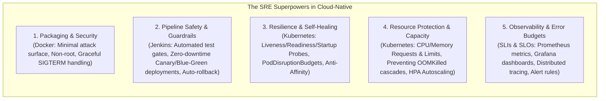
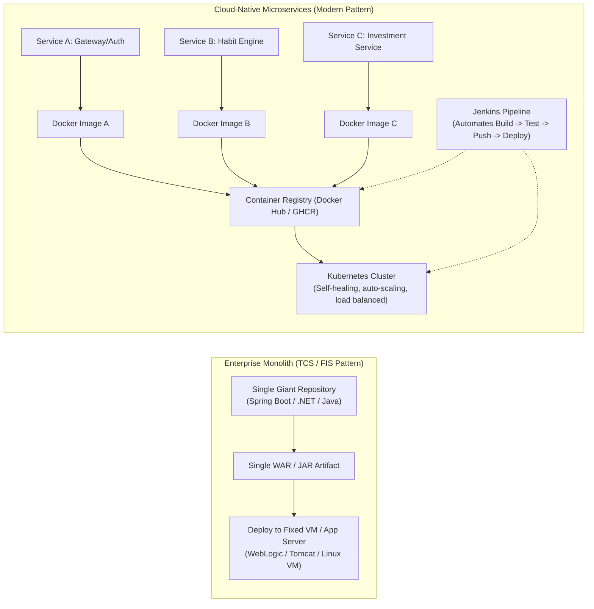
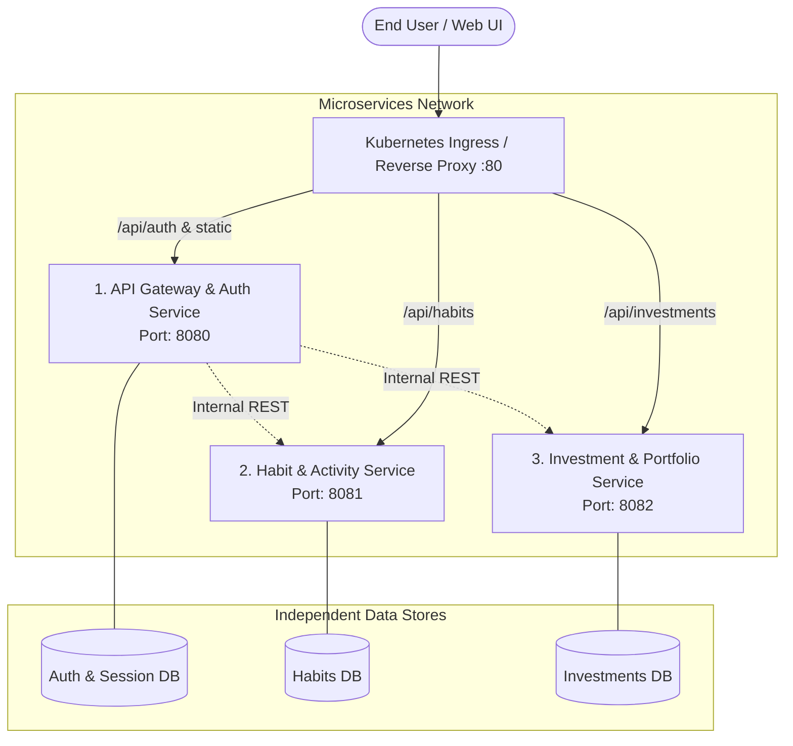
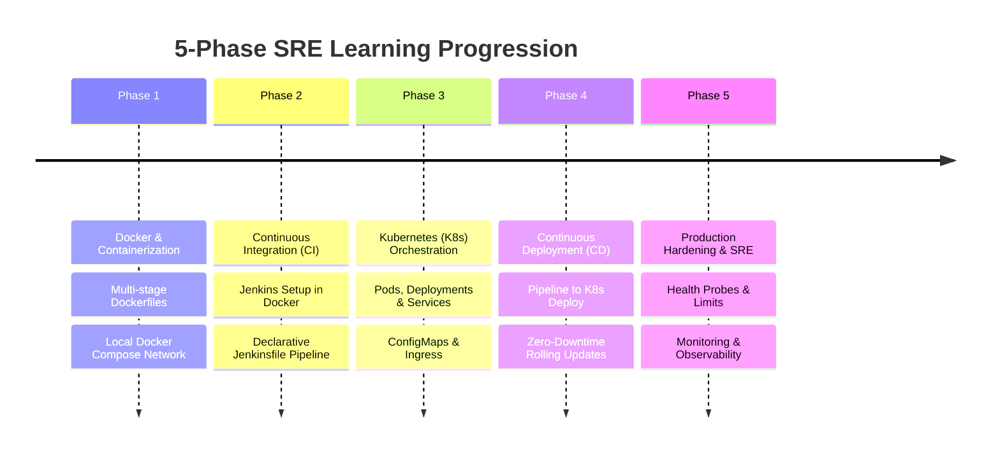

# Enterprise Monolith to Cloud-Native Microservices
## Practical SRE & DevOps Roadmap (Docker, Kubernetes, Jenkins, CI/CD)

---

## 1. What is DevOps? (Why is it Named That?)

In traditional enterprise setups (typical of large banks, FIS Global, TCS, and insurance giants), software delivery suffered from what the industry calls the **"Wall of Confusion"**:

* **Development (Dev)**: Measured on **velocity**—writing new features, creating bug fixes, and throwing the compiled JAR/WAR/ZIP over the wall.
* **Operations (Ops / Sysadmins)**: Measured on **system uptime & stability**—responsible for the production servers, databases, and network. Because production changes are what cause outages, Ops naturally resisted frequent deployments.

Whenever a deployment failed or an outage occurred:
* **Dev blamed Ops**: *"It worked fine on my local machine and in the QA environment! Your server configuration is wrong."*
* **Ops blamed Dev**: *"Your code is leaking memory and eating CPU. We won't deploy your next release until next quarter's maintenance window."*

> **DevOps** is a portmanteau of **Development** and **Operations**. It is a **cultural movement and set of automated engineering practices** designed to tear down that wall. It makes developers and operators share joint ownership of software throughout its entire lifecycle: coding, testing, packaging, deploying, monitoring, and supporting.

---

## 2. SRE vs. DevOps: What is the Difference?

Since your role is an **SRE (Site Reliability Engineer)**, you should understand how SRE fits into the DevOps picture.

The concept of SRE was created at **Google** by Ben Treynor Sloss, who famously described it:
> *"SRE is what happens when you ask a software engineer to design an operations team."*

In software engineering terms:
$$\text{class SRE implements interface DevOps}$$

* **DevOps** defines the **philosophy, goals, and values** (e.g., automate repetitive work, deliver changes in small batches, improve collaboration).
* **SRE** provides the **concrete, programmatic, and mathematical prescription** to achieve those goals.

### Direct Comparison: DevOps vs. SRE

| Dimension | DevOps Focus | SRE Focus |
| :--- | :--- | :--- |
| **Primary Goal** | **Velocity & Delivery Flow**: Accelerate the path from a Git commit to running in production. | **Reliability & Resilience**: Ensure systems stay available, responsive, and resilient under real-world failures and loads. |
| **Core Question** | *"How fast and reliably can we ship this feature?"* | *"What is our error budget, and will this release violate our reliability targets?"* |
| **Key Metrics** | DORA metrics: Deployment Frequency, Lead Time for Changes, Change Failure Rate, Time to Restore. | **SLIs, SLOs, SLAs**, Error Budget burn rates, Mean Time to Detect (MTTD), Mean Time to Resolve (MTTR). |
| **Daily Activities** | Building CI/CD pipelines (Jenkins, GitHub Actions), standardizing Dockerfiles, Infrastructure as Code. | Production observability (metrics, traces, logs), capacity planning, tuning Kubernetes probes/limits, chaos engineering, blameless post-mortems, eliminating **Toil**. |
| **Handling Outages** | Incident triage and post-release fixes. | On-call incident commander, automated self-healing, mitigating blast radius, running automated rollbacks. |

> [!IMPORTANT]
> **What is "Toil" in SRE?**
> Toil is manual, repetitive, automatable work devoid of enduring value (e.g., manually restarting a hung Tomcat server, manually copying files to a VM, manually editing config files). SRE aims to cap toil at `< 50%` of time and spend `> 50%` engineering automated solutions (like Kubernetes operators, self-healing probes, and automated pipelines).

---

## 3. As an SRE, What Should You Specifically Focus On?

When a pure developer learns Docker, Kubernetes, and Jenkins, they focus on: *"How do I package my code and push it to a URL?"*

As an **SRE**, you need those tools, but you look through a **reliability, safety, and observability lens**:



### Detailed SRE Focus per Technology:

#### 1. In Docker:
* **Graceful Shutdown**: Does your app listen for `SIGTERM` signals and cleanly finish active in-flight requests before shutting down, or does it abruptly drop database transactions?
* **Minimal Images & Security**: Running as a non-root user (`USER 1001`), using minimal base images (`alpine` or Google's `distroless`) to reduce vulnerabilities and attack surfaces.
* **Fast Startup Time**: Containers that boot in 2 seconds heal 10x faster during outages than heavy 60-second JVM containers.

#### 2. In Jenkins (CI/CD):
* **Safe Delivery Guardrails**: Automated health verification after deployment before cutting 100% of user traffic over.
* **Automated Rollback**: If HTTP 5xx errors spike right after a release, the pipeline must automatically trigger a rollback (`kubectl rollout undo`).
* **Environment Parity**: Ensuring dev, staging, and production image builds use the identical container SHA.

#### 3. In Kubernetes (K8s) — *The Heart of SRE*:
* **Probes (The Self-Healing Mechanism)**:
  * `startupProbe`: For slow-starting services so K8s doesn't kill them prematurely.
  * `readinessProbe`: Withholds traffic until DB pools and caches are warm (prevents users seeing 502/504 errors during rollouts).
  * `livenessProbe`: Detects deadlocks/hangs and restarts frozen containers.
* **Resource Quotas (Preventing Cascading Failures)**:
  * Setting explicit `requests` (guaranteed CPU/RAM for scheduling) and `limits` (preventing a runaway memory leak from taking down the entire worker node).
* **High Availability & Anti-Affinity**:
  * Ensuring replicas of the same service don't land on the same physical VM or availability zone.
  * `PodDisruptionBudget (PDB)`: Enforcing that at least 80% of service pods remain available during cluster node maintenance.
* **Horizontal Pod Autoscaler (HPA)**:
  * Dynamically adding replicas when CPU or request rate spikes.

#### 4. Observability & Reliability Framework:
* **SLI (Service Level Indicator)**: The quantitative measure of performance (e.g., *latency of successful HTTP requests*).
* **SLO (Service Level Objective)**: The internal target reliability agreed upon (e.g., *99.9% of requests respond in under 200ms over 30 days*).
* **Error Budget**: The permitted 0.1% downtime or bad requests. If the budget burns too fast, feature releases halt and engineering focuses entirely on stability.

---

## 4. Monolith vs. Cloud-Native Mental Model



### Key Differences at a Glance

| Aspect | Traditional Enterprise Monolith | Cloud-Native Microservices |
| :--- | :--- | :--- |
| **Packaging** | WAR / JAR / DLL deployed directly to OS | Standardized **Docker Containers** (runtime + OS libraries bundled) |
| **Deployment Target** | Static Linux VMs or bare-metal servers | **Kubernetes Cluster** (dynamic pool of nodes) |
| **Scaling** | Scale the entire monolith vertically or spin up another heavy VM | Scale individual services horizontally based on traffic spikes |
| **Failure Blast Radius** | Memory leak in one module crashes the entire application | Single service crash is isolated; Kubernetes automatically restarts it |
| **Release Process** | Monthly/Quarterly release windows with manual checklists | Automated CI/CD pipelines pushing updates multiple times a week |
| **Configuration** | Static `application.properties` embedded in build or on VM disk | Injected at runtime via Kubernetes **ConfigMaps** and **Secrets** |

---

## 5. The Target 3-Tier Microservices Architecture

To learn effectively, we build a realistic 3-service platform instead of toy examples:



### Service Responsibilities:
1. **Service 1: API Gateway & Auth Service (`:8080`)**
   - Serves frontend UI assets and handles user authentication (JWT tokens).
   - Routes incoming requests to internal backend services.
2. **Service 2: Habit & Activity Service (`:8081`)**
   - Manages daily activity logging, streaks, and habit tracking.
   - Independent database store.
3. **Service 3: Investment & Portfolio Service (`:8082`)**
   - Handles asset tracking, net worth calculations, transaction logs.
   - Independent database store.

---

## 6. Phase-by-Phase Hands-On Implementation Plan



---

### Phase 1: Docker & Containerization (The Foundation)

#### Goal:
Package each of the 3 services so they run cleanly, securely, and identically on any machine without local dependencies.

#### What You Will Learn & Build:
1. **Multi-Stage `Dockerfile`s**:
   - *Stage 1 (Builder)*: Compiles the source code with full build tools.
   - *Stage 2 (Runner)*: Copies only the compiled artifact to a minimal Alpine/Distroless Linux image (keeps image size under 150MB instead of 1GB).
2. **Image Optimization & Security**:
   - Layer caching: Placing dependency manifests (`package.json`, `pom.xml`, `requirements.txt`) before source code to optimize build speeds.
   - Non-root user execution (`USER 1001`) to prevent container breakout exploits.
   - `.dockerignore` to keep repository bloat (`node_modules`, `.git`, build logs) out of containers.
3. **Local Multi-Service Orchestration (`docker-compose.yml`)**:
   - Spin up all 3 services + PostgreSQL + Redis with one command: `docker compose up --build`.
   - Understand **Docker Bridge Networks**: how `service-gateway` connects to `http://service-habits:8081` using container names instead of IP addresses.
   - Volume mounts for persistent data (`postgres-data:/var/lib/postgresql/data`).

---

### Phase 2: Continuous Integration (CI) with Jenkins

#### Goal:
Automate the build, test, and container packaging process every time code is committed.

#### What You Will Learn & Build:
1. **Running Jenkins Locally**:
   - Run Jenkins inside a Docker container on your Mac, mounting the Docker socket so Jenkins can build Docker images (*Docker-in-Docker / Docker-outside-of-Docker*).
2. **Declarative Pipeline (`Jenkinsfile`)**:
   ```groovy
   pipeline {
       agent any
       environment {
           REGISTRY = "docker.io/myusername"
           IMAGE_TAG = "${env.BUILD_NUMBER}-${env.GIT_COMMIT.take(7)}"
       }
       stages {
           stage('Code Checkout') {
               steps { checkout scm }
           }
           stage('Unit & Integration Tests') {
               steps {
                   sh 'npm test' // or 'mvn test' / 'pytest'
               }
           }
           stage('Build Docker Image') {
               steps {
                   sh "docker build -t ${REGISTRY}/habit-service:${IMAGE_TAG} ./services/habit-service"
               }
           }
           stage('Push Image to Registry') {
               steps {
                   withCredentials([usernamePassword(credentialsId: 'docker-hub-creds', usernameVariable: 'USER', passwordVariable: 'PASS')]) {
                       sh "echo $PASS | docker login -u $USER --password-stdin"
                       sh "docker push ${REGISTRY}/habit-service:${IMAGE_TAG}"
                   }
               }
           }
       }
   }
   ```
3. **Key Concepts Mastered**:
   - Pipeline stages, environment variables, secret management in Jenkins credentials store.
   - Immutable artifact tagging with Git commit SHAs.

---

### Phase 3: Container Orchestration with Kubernetes (K8s)

#### Goal:
Move from running containers on a single machine (`docker-compose`) to managing a resilient cluster.

#### What You Will Learn & Build:
1. **Local Kubernetes Cluster**:
   - Enable Kubernetes in **Docker Desktop**, or install **Minikube** / **k3d** on your Mac.
   - Configure `kubectl` to communicate with the cluster.
2. **Core Kubernetes Primitives**:
   - **Pod**: The smallest unit; wraps one or more containers.
   - **Deployment**:
     - Declares desired state: `replicas: 3`.
     - Rolling updates: Updates pods sequentially with zero downtime.
     - Self-healing: Automatically replaces pods if they crash.
   - **Service**:
     - `ClusterIP`: Gives a stable internal virtual IP and DNS name across ephemeral pods.
     - Internal load balancing across pod replicas.
   - **ConfigMap & Secret**:
     - Decouple configuration from code.
     - Store DB connection strings, environment names, and credentials securely.
   - **Ingress Controller**:
     - Routes external HTTP/HTTPS traffic to internal services using path-based rules:
       - `/api/habits` $\rightarrow$ `habit-service:8081`
       - `/api/investments` $\rightarrow$ `invest-service:8082`

---

### Phase 4: Continuous Deployment (CD) & GitOps

#### Goal:
Connect Jenkins and Kubernetes so that every successful build automatically deploys to the cluster without human intervention.

#### What You Will Learn & Build:
1. **Automated K8s Deployment in Jenkins**:
   - Add a deployment stage to your `Jenkinsfile`:
     ```groovy
     stage('Deploy to Kubernetes') {
         steps {
             sh "kubectl set image deployment/habit-deployment habit-container=${REGISTRY}/habit-service:${IMAGE_TAG}"
             sh "kubectl rollout status deployment/habit-deployment"
         }
     }
     ```
2. **Zero-Downtime Verification**:
   - Observe `kubectl get pods -w` while Jenkins triggers a rollout.
   - Understand how K8s starts the new container, waits for it to be ready, routes traffic, and only then terminates the old container.
3. **Rollback Strategy**:
   - How to immediately rollback a failed release: `kubectl rollout undo deployment/habit-deployment`.

---

### Phase 5: Production Hardening & SRE Observability

#### Goal:
Make the microservices platform production-grade, matching enterprise financial standards.

#### What You Will Learn & Build:
1. **Health Probes**:
   - `livenessProbe`: Restarts the pod if it hangs or deadlocks.
   - `readinessProbe`: Withholds traffic until the service has established DB connections and warmed up.
2. **Resource Requests & Limits**:
   - Prevent noisy neighbor issues: enforce CPU (e.g., `requests: 100m, limits: 500m`) and RAM (e.g., `requests: 256Mi, limits: 512Mi`).
3. **Centralized Logging & Metrics**:
   - Inspecting pod logs: `kubectl logs -f deployment/habit-deployment`.
   - High-level introduction to Prometheus (metrics) and Grafana (dashboards).

---

## 7. Essential Command Cheat Sheet

### Docker
```bash
# Build an image
docker build -t habit-service:v1.0 .

# Run container with port forwarding and environment variables
docker run -d -p 8081:8081 -e PORT=8081 --name habit-app habit-service:v1.0

# View running containers & logs
docker ps
docker logs -f habit-app

# Run the entire multi-service stack
docker compose up --build -d
docker compose down
```

### Kubernetes (`kubectl`)
```bash
# Check cluster status and nodes
kubectl get nodes
kubectl cluster-info

# View running resources
kubectl get pods -o wide
kubectl get deployments
kubectl get services

# Apply declarative YAML manifests
kubectl apply -f k8s/

# Stream logs of a deployment
kubectl logs -l app=habit-service -f

# Check why a pod is failing (crucial for debugging)
kubectl describe pod <pod-name>

# Check rollout status and undo
kubectl rollout status deployment/habit-deployment
kubectl rollout undo deployment/habit-deployment
```

---

## 8. Recommended Next Steps

1. **Confirm Technology Stack**: Decide which backend language to write the microservices in (e.g. Node.js/Express, Python/FastAPI, or Java/Spring Boot).
2. **Check Mac Environment**:
   - Verify Docker Desktop installation (`docker --version`).
   - Enable Kubernetes checkbox in Docker Desktop settings.
3. **Start Phase 1**:
   - Create the directory structure for the 3 services and author the first `Dockerfile`.
