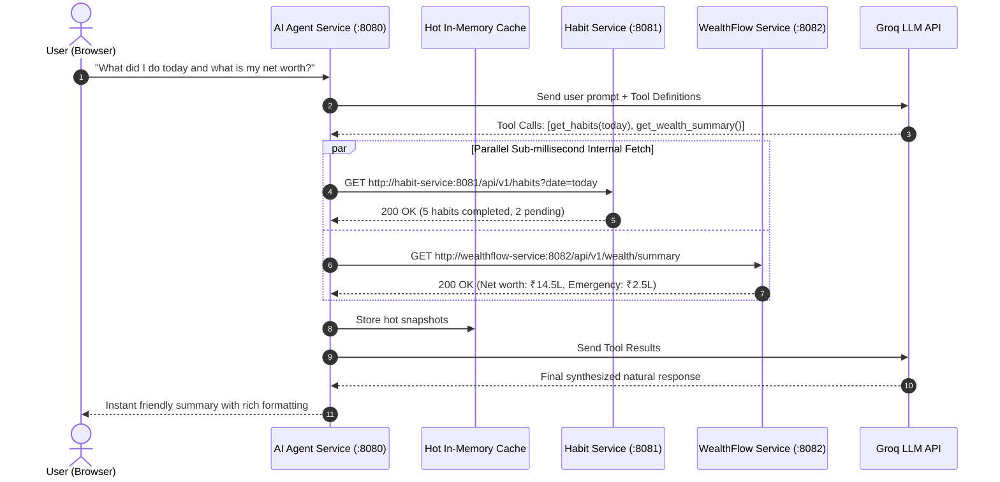
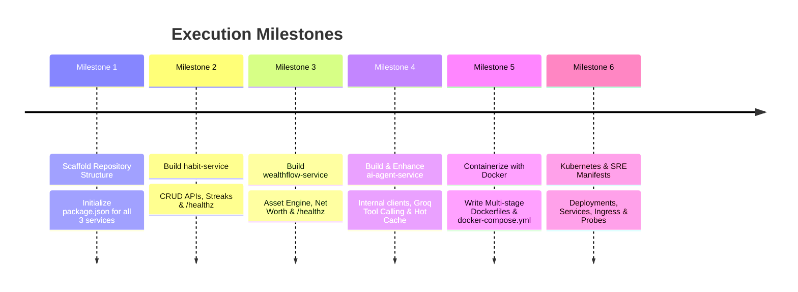

# 3-Microservices Platform & Enhanced AI Agent
## Architectural Specification and Implementation Plan

---

## 1. Executive Summary & Problem Statement

### Current State (Monolithic Client)
Currently, all logic is consolidated inside a single ~1,665-line client-side script (`js/app_v3.js`).
* The browser makes direct, un-indexed HTTP calls across the public internet to three separate Google Apps Script (GAS) web apps:
  * `HABIT_GAS_URL` (Habit Tracker)
  * `INVEST_GAS_URL` (Investments / WealthFlow)
  * `AI_CHAT_GAS_URL` (Groq LLM Proxy)
* **Bottlenecks**:
  * **High Latency**: Each query incurs 1,000ms – 2,500ms of external round-trip delay.
  * **Brittle Coordination**: When the AI agent needs both habit and investment data, it executes sequential, slow HTTP calls from the browser.
  * **CORS & Reliability Issues**: Script endpoints have rate limits, no database indexing, and intermittent timeout risks.
  * **Security**: Business logic, asset registries, and sync keys are exposed directly in client JavaScript.

### Target State (Microservices Architecture)
We decompose this system into **three standalone, containerized microservices** running on an internal virtual network, managed by Docker and Kubernetes.

```mermaid
flowchart TD
    Client([Browser / Mobile Client: Leo UI]) -->|HTTP Port 8080| Gateway[AI Agent Service :8080\n(Web Server + LLM Orchestrator + Hot Cache)]

    subgraph InternalNet [Private Docker / K8s Network (< 2ms Latency)]
        Gateway -->|REST /api/v1/habits| HabitService[Habit Service :8081\n(Daily status, streaks, completion)]
        Gateway -->|REST /api/v1/wealth| WealthService[WealthFlow Service :8082\n(Asset registry, net worth, portfolio calculations)]
        
        HabitService --- HabitDB[(Habits Storage / DB)]
        WealthService --- WealthDB[(WealthFlow Storage / DB)]
    end

    Gateway -.->|External API Call| GroqLLM[Groq LLM Cloud API\n(gpt-oss-120b / llama-3)]
```

---

## 2. Microservice Specifications

### Service 1: `habit-service` (Port 8081)
* **Domain Responsibility**: Pure habit state management, date normalization, streaks, and completion logging.
* **Core REST Endpoints**:
  | Method | Endpoint | Description |
  | :--- | :--- | :--- |
  | `GET` | `/api/v1/habits` | Retrieves habits list, completion status, and streaks for a given date (`?date=YYYY-MM-DD`). |
  | `POST` | `/api/v1/habits/update` | Batch check/uncheck habits for a date (`{ date, action: "check"|"uncheck", habit_ids: [...] }`). |
  | `POST` | `/api/v1/habits` | Create or update a habit definition (name, target frequency). |
  | `GET` | `/healthz` | SRE health probe (returns HTTP 200 `{ status: "ok" }`). |
  | `GET` | `/metrics` | Prometheus metrics (request latency, 2xx/5xx counters). |

---

### Service 2: `wealthflow-service` (Port 8082)
* **Domain Responsibility**: Asset registry, monthly portfolio records, investment logging, net worth summation, and asset name fuzzy-matching.
* **Core REST Endpoints**:
  | Method | Endpoint | Description |
  | :--- | :--- | :--- |
  | `GET` | `/api/v1/wealth/summary` | Fast calculation of total net worth, category allocations, emergency fund, and goals. |
  | `GET` | `/api/v1/wealth/month/:month` | Retrieves asset-by-asset breakdown for a specific month (`2026-09`). |
  | `POST` | `/api/v1/wealth/record` | Log or update investments for an asset in a given month. |
  | `DELETE` | `/api/v1/wealth/month/:month` | Safely remove records for a specified month alone. |
  | `GET` | `/healthz` | SRE health probe (HTTP 200). |
  | `GET` | `/metrics` | Prometheus metrics. |

---

### Service 3: `ai-agent-service` (Port 8080 — The Brain)
* **Domain Responsibility**:
  1. Serves the static Leo Web UI (`public/index.html`, `styles.css`).
  2. Ingests user natural language chat queries (`POST /api/v1/chat`).
  3. Executes LLM tool calling against the internal microservices network.
  4. Manages in-memory caching and session state.

---

## 3. How the AI Agent is Enhanced for Faster & Better Retrieval



### The 5 Architectural Enhancements:

1. **Sub-Millisecond Internal Network (Zero Public Latency)**:
   * Instead of browser-to-cloud round trips across the internet, the AI Agent talks to `habit-service` and `wealthflow-service` over Docker/K8s private bridge networking. Request times drop from **1,500ms to < 2ms**.
2. **Parallel Tool Dispatch (`Promise.all`)**:
   * If an intent spans multiple services (e.g. *"Show my status today and how much I invested this month"*), both backend services are queried concurrently in parallel rather than sequentially.
3. **In-Memory Hot Snapshotting**:
   * Today's habit state and the latest month's portfolio summary are cached in memory on the Agent. Rapid follow-up queries (*"what is pending?", "did I do language?", "emergency fund?"*) are served in **< 10ms** with zero database churn.
4. **Strict JSON Schema & Disambiguation Engine**:
   * The fuzzy asset matching (`Digi Gold` vs `Gold ETF`, `ICICI Bank` vs `ICICI Nifty 50`) is moved from messy frontend regex into the dedicated `wealthflow-service` domain layer, guaranteeing zero LLM hallucinations.
5. **SRE Resilience & Graceful Degradation**:
   * If `wealthflow-service` is restarting or redeploying, circuit breakers catch the error: the AI agent still answers habit questions and politely notifies the user that investment data is briefly refreshing, rather than crashing the whole chat.

---

## 4. Repository & Directory Structure Blueprint

```text
ai-agent/
├── services/
│   ├── habit-service/
│   │   ├── src/
│   │   │   ├── index.js          # Express app & SRE /healthz
│   │   │   ├── routes.js         # /api/v1/habits endpoints
│   │   │   └── store.js          # Data access & streak calculations
│   │   ├── package.json
│   │   ├── .dockerignore
│   │   └── Dockerfile            # Multi-stage production container
│   │
│   ├── wealthflow-service/
│   │   ├── src/
│   │   │   ├── index.js          # Express app & SRE /healthz
│   │   │   ├── routes.js         # /api/v1/wealth endpoints
│   │   │   ├── assetRegistry.js  # Asset master catalog & fuzzy matcher
│   │   │   └── portfolio.js      # Net worth, monthly aggregation engine
│   │   ├── package.json
│   │   ├── .dockerignore
│   │   └── Dockerfile            # Multi-stage production container
│   │
│   └── ai-agent-service/
│       ├── src/
│       │   ├── server.js         # HTTP server, serves UI & /api/v1/chat
│       │   ├── orchestrator.js   # Groq LLM tool calling engine
│       │   ├── serviceClients.js # Internal HTTP clients (Habit & WealthFlow)
│       │   └── hotCache.js       # In-memory snapshot cache
│       ├── public/               # Client UI
│       │   ├── index.html        # Leo AI Agent UI
│       │   └── styles.css        # Glassmorphism styling
│       ├── package.json
│       ├── .dockerignore
│       └── Dockerfile            # Multi-stage production container
│
├── docker-compose.yml            # Local multi-service cluster
├── k8s/                          # Kubernetes Manifests
│   ├── habit-deployment.yaml
│   ├── wealthflow-deployment.yaml
│   └── ai-agent-deployment.yaml
└── docs/
    ├── microservices_devops_roadmap.md
    └── microservices_implementation_plan.md
```

---

## 5. Step-by-Step Implementation Roadmap



---

### Milestone 1: Scaffolding
* Create `services/habit-service`, `services/wealthflow-service`, and `services/ai-agent-service`.
* Set up standard lightweight dependencies (`express`, `cors`, `dotenv`).

### Milestone 2: `habit-service` Implementation
* Implement `GET /api/v1/habits` and `POST /api/v1/habits/update`.
* Add date utilities (support for today, yesterday, ISO dates).
* Implement SRE endpoints (`/healthz`).

### Milestone 3: `wealthflow-service` Implementation
* Implement `GET /api/v1/wealth/summary` and `POST /api/v1/wealth/record`.
* Port asset matching catalog (MFs, Stocks, EPF, PPF, NPS, Digi Gold, Car Fund).
* Implement SRE endpoints (`/healthz`).

### Milestone 4: Enhanced `ai-agent-service`
* Implement `serviceClients.js` calling `http://habit-service:8081` and `http://wealthflow-service:8082`.
* Implement Groq tool calling pipeline with parallel execution (`Promise.all`).
* Wire up `public/index.html` to talk to local `/api/v1/chat`.

### Milestone 5: Docker & Docker Compose
* Author multi-stage `Dockerfile` for each service (Node.js Alpine base, non-root user).
* Build `docker-compose.yml` defining networks, environment variables, and ports.
* Test spinning up all 3 services with:
  ```bash
  docker compose up --build
  ```

### Milestone 6: Kubernetes & SRE Hardening
* Write Kubernetes manifests with `livenessProbe` and `readinessProbe` targeting `/healthz`.
* Configure resource `requests` and `limits`.
* Set up internal K8s `ClusterIP` services and `Ingress`.
